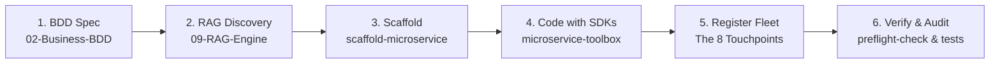

# AGENTS.md: 08-Squad-Agent

## Service Mission & Architecture Role
`08-Squad-Agent` is the operational engine room, autonomous AI squad coordinator, and fleet governance automation hub for the Bastien-Antigravity ecosystem. It exposes a unified CLI router (`main.py`) providing 33 commands for ecosystem health audits, fleet-wide git and architecture management, automated microservice scaffolding, and AI persona synchronization.

- **Exposed Capability**: `squad_agent`
  - **REST & OpenMFE Web**: Port `8085` (`capabilities.squad_agent.port`)
  - **gRPC Squad Control**: Port `8087` (`capabilities.squad_agent.grpc_port`)
  - **OpenMFE Dynamic Registration**: Auto-registers with `web-interface` (`127.0.0.1:5000` via `/api/v1/register`) with infinite background retry and exponential backoff
- **Unified CLI Entrypoint**: `python3 08-Squad-Agent/main.py <command> [args...]`
- **Execution Environment**: Vault Python virtual environment (`.venv`) initialized via `src/bootstrap` using `microservice-toolbox` Python bindings.
- **RAG Engine Integration**: Paired with [`09-RAG-Engine`](../09-RAG-Engine) for semantic context retrieval, interface discovery, and AST code queries.
- **Shared Libraries**: `microservice-toolbox`, `universal-logger`, `distributed-config`
- **Database Dependency**: PostgreSQL with dynamic schema `08-Squad-Agent` in `obsidiandb`
- **Configuration Link**: `standalone.yaml -> ../docker-deployment/modes/local/config/native.yaml`
- **Operational Requirement (`GITHUB_TOKEN`)**: The REST API and OpenMFE dashboard require `GITHUB_TOKEN` in the environment. If unset, `/api/v1/status` returns `healthy: false, status: disabled` and management endpoints return HTTP 403.

---

## Unified Command Directory (33 Commands)

All operational scripts are invoked through the central `main.py` router:

### 1. Squad Lifecycle & Scaffolding
- `squad-agent`: Main orchestrator. Runs preflight audits, synchronizes agent roles, and boots the AI squad environment.
- `scaffold-microservice`: **Automated Microservice Generator**. Scaffolds new Go, Python, or Rust microservices with standard directories, the 12 mandatory root files & folders, BDD spec stubs, and registration snippets.
- `scaffold-new-brain`: Generates a new standardized Obsidian documentation vault.
- `init-new-brain`: Resets and initializes a fresh Obsidian workspace vault with standard structural folders and governance templates.
- `switch-mode`: Protocol switcher toggling between Spec-First, Labs, and Fleet operational modes.
- `unlock-vault`: Removes KMS lock protections on sensitive vault files to permit maintenance and updates.
- `install-git-hooks`: Installs repository pre-commit and pre-push hooks across the fleet.
- `mission-help`: Displays detailed usage help, subcommand documentation, and structural layout requirements.

### 2. Auditing & Health Verification
- `preflight-check`: Mandatory pre-session audit verifying configuration validity, ports, dynamic semver, and environment integrity across 8 gates.
- `audit-ports`: **4-Layer Port Drift Verification Engine**. Scans `native.yaml`, `docker-compose.yaml`, `service-registry.json`, and architecture markdown guides to guarantee zero port drift.
- `validate-compliance`: **Mechanical Code Invariant Auditor**. Scans Go, Python, Rust, and C++ code to mechanically verify shebang/encoding, Triple-Block headers, section dividers, dynamic port usage, and absence of test mocks.
- `format-compliance`: **AST Compliance Refactorer**. Auto-repairs Python code formatting, headers, dividers, and imports (`--fix`).
- `brain-health-audit`: Scans the entire `obsidian-brain` vault for orphan notes, missing tags, and invalid frontmatter.
- `check-coherence`: Audits runtime agent skills against vault role prompts to ensure 100% coherence across all 21 squad roles.
- `ensure-frontmatter`: Validates and repairs YAML frontmatter across all markdown files.
- `hardening-yaml`: Audits and hardens ecosystem YAML files against syntax and schema drift, enforcing folder zone taxonomies.

### 3. Fleet & Feature Management
- `build-inventory`: **Fleet Inventory Builder**. Scans workspace repositories and regenerates `05-Fleet-Operation/inventory.json`.
- `fleet-commander`: Fleet-wide git and deployment coordinator. Interacts with `05-Fleet-Operation/00-Repo-Control/fleet-manager.py` to enforce compliance and manage multi-repo pushes.
- `fleet-refresh`: Synchronizes local git branches, pulls updates across submodules, and refreshes the repository workspace state.
- `fleet-init-update`: Generates and propagates standardized `AI-Init.md` instructions across all registered repositories in the fleet.
- `fleet-version`: Audits and verifies dynamic semantic versioning across all 14 fleet repositories against `VERSION.txt`.
- `bump-version`: Increments semantic versioning (patch, minor, major) across fleet repositories and updates `VERSION.txt`.
- `map-feats`: Maps BDD feature specifications (`02-Business-BDD`) to concrete implementation code.
- `fix-feats`: Auto-aligns feature documentation status with actual codebase state.
- `close-mission`: Performs terminal session wrap-up, updates `AI-Session-State.md`, and persists context.
- `convert-agents`: **AI Persona Compiler**. Reads the 21 squad role prompts (14 base squad roles + 7 language specialist developers) from `07-Core-KMS/Role-Prompts/` and compiles them into active Antigravity skills in `.agents/skills/<role>/SKILL.md`.

### 4. Knowledge, Dispatching & Interfaces
- `agent-dispatcher`: Automated task dispatcher routing work to specific AI agent personas based on frontmatter or semantic keywords.
- `controller`: Invokes unified command router execution, handling direct subprocess spawning and command outputs.
- `discord-client`: Connects Discord chat channels to the unified squad command controller.
- `knowledge-compressor`: Distills session transcripts and log buffers into persistent knowledge items.
- `persona-extractor`: Analyzes codebase patterns and updates agent persona specializations.
- `joint-audit-purger`: Identifies obsolete notes, orphan branches, and dead code candidates.
- `maintenance-skill`: Triggers routine squad index checks, compacts local databases, and audits system metadata files.

---

## Autonomous Microservice Development Workflow

Whenever an AI agent is tasked with creating a new microservice or modifying an existing one, it **MUST** execute the standard 6-phase lifecycle:

1. **BDD Specification (`02-Business-BDD`)**:
   - Locate or author the feature specification in `02-Business-BDD/02-Behavior-Specs/<service>/FEAT-*.md`.
   - Verify user story, Gherkin scenarios (`Given`/`When`/`Then`), and acceptance criteria.
2. **Architecture & RAG Discovery (`03-Tech-Stack` & `09-RAG-Engine`)**:
   - Query RAG for existing interfaces, protocols, and ADRs.
   - Confirm compliance with `03-Tech-Stack/02-Project-Architecture/` standards (`11-Microservice-Integration-Standard.md`, `12-Docker-Deployment-Standards.md`).
3. **Automated Scaffolding (`scaffold-microservice`)**:
   - Run `python3 08-Squad-Agent/main.py scaffold-microservice --name <service-name> --lang <go|python|rust>` to generate the clean skeleton and all 12 mandatory root files & folders.
4. **Implementation via Ecosystem SDKs**:
   - Use `microservice-toolbox` for `BootstrapService`, dynamic port resolution (`get_listen_addr`), and lifecycle management.
   - Use `universal-logger` for structured logging.
   - Use `safe-socket` for high-throughput framed TCP transports.
5. **Ecosystem Fleet Registration (The 8 Touchpoints)**:
   - 1. Register in `05-Fleet-Operation/00-Repo-Control/service-registry.json` (canonical port, image, protocol).
   - 2. Register in `05-Fleet-Operation/00-Repo-Control/inventory.json` (repository path, remote, branch).
   - 3. Add capability block to `docker-deployment/modes/local/config/native.yaml`.
   - 4. Add container service to `docker-deployment/docker-compose.yaml`.
   - 5. Add container service slice to `docker-deployment/modes/docker/config/services/<name>.yaml`.
   - 6. Register service spec in `docker-deployment/scripts/common.py` (`SERVICES_SPEC`).
   - 7. Register symlink in `watchdog-agent/src/config/heal.go`.
   - 8. If UI/API exists, register OpenMFE with `web-interface` (port 5000) or C2 with `tele-remote` (port 1863).
6. **Verification & Preflight Audit**:
   - Run unit tests: `go test -v ./...` / `pytest` / `cargo test`.
   - Run preflight check: `python3 08-Squad-Agent/main.py preflight-check`.
   - Update `AI-Session-State.md`.

---

## AI Development Guidelines
1. **Bootstrap Pattern**: Python modules in this directory import `src.bootstrap` to redirect execution to the virtualenv and initialize `microservice-toolbox` config and logger singletons.
2. **Dynamic Port Resolution & Fail-Fast Principle**: Always resolve listening ports via `config.get_listen_addr(...)`. Never hardcode fallback port numbers; if unresolvable, fail-fast immediately per ecosystem standard.
3. **Triple-Block Header**: Every Python file MUST begin with the Triple-Block docstring (`ESSENTIAL PROCESS`, `DATA FLOW`, `KEY PARAMETERS`).
4. **Section Dividers**: Use `# -----------------------------------------------------------------------------` between top-level functions and classes.
5. **Never Hardcode Paths**: Always resolve the workspace root dynamically via `resolve_vault_and_workspace(__file__)` or `bootstrap`.
6. **GITHUB_TOKEN Environment Guard**: For dashboard and REST health management, ensure `GITHUB_TOKEN` is exported in the runtime environment.

